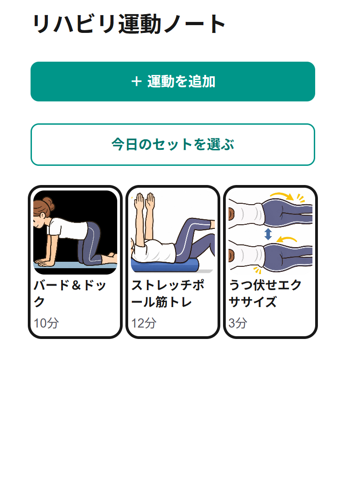
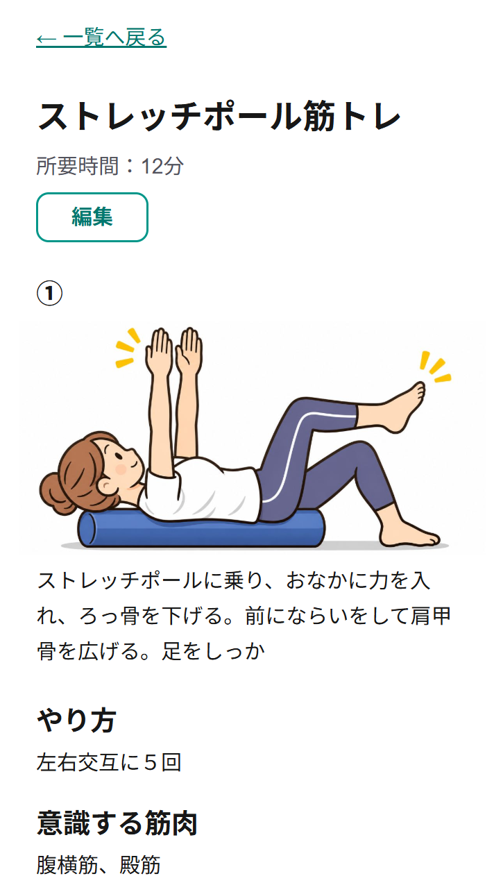
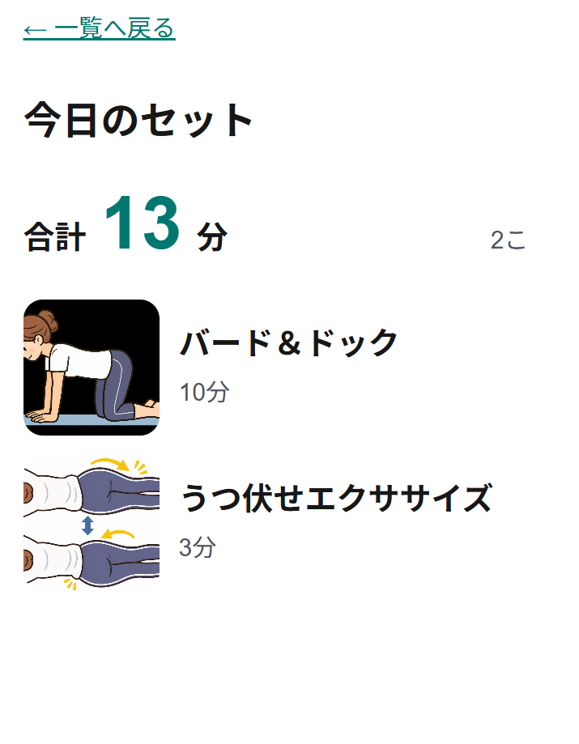
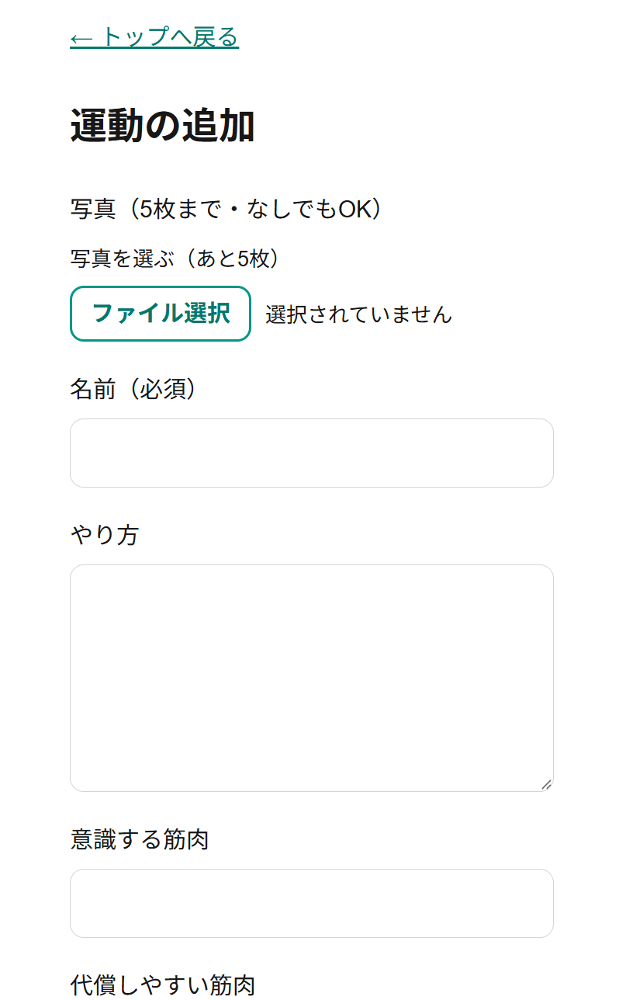

# リハビリ運動ノート

リハビリで教わった運動を、写真つきで記録していつでも見返せるスマホ向けアプリです。

**公開 URL：** https://rehab-note.vercel.app

## だれのためのアプリか・どんな困りごとを解決するか

### だれのため
リハビリを受けていて、退院したあとも自分でセルフケアを続けていく人（作った本人）のためのアプリです。

### 困りごと
- リハビリで教わった運動を、時間がたつと忘れてしまう
- 紙やノートに書いても、あとで探すのが大変
- アプリに記録しても全体を見渡しにくく、見返さなくなってしまう

### 解決すること
教わった運動をいつでも写真つきで確認できるようにして、運動の直前にすぐ正しいやり方を見返せるようにします。
セルフケアを続けて、体が痛くならない状態を保つことが目的です。

## 主な機能

- **運動の追加**：写真（0〜5枚、1枚ごとに短い説明つき）・名前・やり方・意識する筋肉・代償しやすい筋肉・所要時間を記録
- **一覧**：トップの写真と名前を、スマホのホーム画面のように横3列のタイルで表示
- **詳しいページ**：①②③…の番号順に、写真と説明を上から並べて表示
- **編集・削除**：内容の修正、写真を1枚ずつ足す・消す、トップの写真の選び直し、運動の削除
- **今日のセット**：一覧から今日やる運動を選び、合計時間を表示
- **見やすさ**：文字は大きめ、ピンチで拡大できる、写真は保存するときに軽くして表示を速くする

## スクリーンショット

| 一覧 | 詳しいページ | 今日のセット | 追加 |
|---|---|---|---|
|  |  |  |  |

## ログインについて

- 個人の運動の記録なので、ログインできるのは本人だけです
- 新規登録の画面はありません（アカウントは作成者のもの1つだけです）
- 運動のデータと写真は、本人しか見られないようにしています（Supabase の RLS と非公開ストレージ）

## 技術スタック

- **画面**：Next.js 16（App Router）／React 19／TypeScript／Tailwind CSS v4
- **ログイン**：Supabase Auth（メールアドレス＋パスワード）
- **データ・写真の保存**：Supabase（データベース・Storage）
- **公開**：Vercel

## 使った Claude Code の機能

- **Plan Mode**：実装の前に計画を出してもらい、確認してから作りました
- **/init**：`/init` で CLAUDE.md を作りました
- **CLAUDE.md**：作業ルール（1機能ずつ作る・日本語でかんたんに説明する・requirements.md を正とする など）を書いておき、毎回守ってもらいました
- **@参照**：`@requirements.md` のようにファイルを指定して、要件を読んでもらいました
- **コミットと push**：localhost で確認して OK を出したあと、コミットと push を Claude Code にまかせました
- **エラーの相談**：エラーの内容をそのまま渡して、原因と直し方を計画してもらいました
- **メモリ**：進み具合をメモリに記録しておき、次の日に続きから始めました

## 見本のイラストについて

アプリの画面（スクリーンショット）に写っている運動の見本イラストは、ChatGPT で作成しました。
